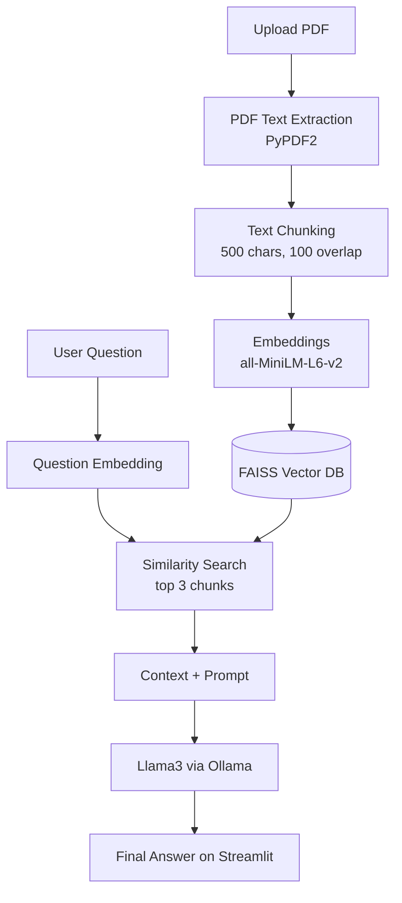

# Intelligent Document Question Answering System using RAG & LLM

An AI-powered web app that lets you **upload a PDF and ask questions about its content**. It uses **Retrieval Augmented Generation (RAG)** with a locally running **Llama3** model, so answers are grounded in your document and everything runs offline, privately, and with no API cost.

---

## Overview

The app reads a PDF, extracts its text, splits it into overlapping chunks, converts the chunks into embeddings, stores them in a **FAISS** vector database, retrieves the most relevant chunks for a question, and generates an answer with **Llama3** (via **Ollama**). The prompt instructs the model to answer **only from the retrieved context**, and to say so when the answer is not in the PDF.

**Concepts demonstrated:** Generative AI · LLMs · RAG · Embeddings · Vector Databases · Semantic Search · Transformer Architecture · Prompt Engineering · Local AI Deployment

---

## Problem Statement

Reading large documents (research papers, reports, legal agreements, technical documentation) manually is slow. Keyword search cannot understand meaning, and LLMs alone cannot see your private documents. RAG solves this by combining **semantic retrieval** with **context-aware generation**.

---

## Features

- Upload any text-based PDF
- Preview of the extracted text
- Metrics for total characters, total chunks, and chunk size
- Semantic search over the document (meaning-based, not keyword-based)
- Expandable view of the retrieved context behind each answer
- Context-grounded answers from Llama3
- 100% local: offline, free, and private
- Built-in tabs for project flow and technical concepts

---

## Architecture



---

## Tech Stack

| Technology | Purpose |
|---|---|
| **Python** | Core language |
| **Streamlit** | Web-based UI |
| **PyPDF2** | PDF text extraction |
| **Sentence Transformers** (`all-MiniLM-L6-v2`) | Embedding generation |
| **Hugging Face Hub** | Downloads and manages the embedding model |
| **FAISS** (`faiss-cpu`) | Vector database and similarity search |
| **NumPy** | Array handling, float32 conversion for FAISS |
| **Requests** | HTTP calls to the Ollama API |
| **Ollama** | Local LLM runtime |
| **Llama3** | Large Language Model (Meta AI) |

---

## Core Functions

| Function | Purpose |
|---|---|
| `extract_text_from_pdf()` | Extracts text from every page of the uploaded PDF |
| `split_text_into_chunks()` | Splits text into overlapping chunks (default 500 chars, 100 overlap) |
| `load_embedding_model()` | Loads the Sentence Transformer model once (cached) |
| `create_vector_database()` | Creates embeddings and stores them in a FAISS `IndexFlatL2` index |
| `search_relevant_chunks()` | Retrieves the top-k (default 3) most similar chunks for a question |
| `ask_llm()` | Builds the prompt and sends it to Llama3 through Ollama |
| `show_project_flow()` | Displays the RAG flow in the UI |

---

## Prerequisites

- **Python 3.8+** and **pip**
- **Ollama** installed: https://ollama.com/download

---

## Installation

### 1. Clone the repository

```bash
git clone <your-repo-url>
cd <your-repo-folder>
```

### 2. Install Python dependencies

```bash
pip install --upgrade pip
pip install -r requirements.txt
```

> On macOS / Linux, use `pip3` instead of `pip`.

<details>
<summary>Or install packages one by one</summary>

```bash
pip install streamlit
pip install PyPDF2
pip install numpy
pip install requests
pip install faiss-cpu
pip install sentence-transformers==3.3.1
pip install huggingface-hub==0.25.2
```

</details>

### 3. Install Ollama

| OS | Command |
|---|---|
| **Windows** (PowerShell, Windows 10 or later) | `irm https://ollama.com/install.ps1 \| iex` |
| **macOS / Linux** | `curl -fsSL https://ollama.com/install.sh \| sh` |

You can also download the installer from https://ollama.com/download.

### 4. Download and run Llama3

```bash
ollama pull llama3
ollama run llama3
```

> Keep this terminal running while you use the app.

---

## Run the Application

Open **another terminal** in the project folder:

```bash
streamlit run app.py
```

Alternative (if the `streamlit` command is not found):

```bash
python -m streamlit run app.py      # Windows
python3 -m streamlit run app.py     # macOS / Linux
```

Then open the URL shown in the terminal (usually http://localhost:8501).

### Usage

1. Upload a PDF in the **Upload PDF** tab.
2. Wait for the vector database to be created.
3. Type your question.
4. View the generated answer (and expand the retrieved context if you want to see the source text).

---

## Troubleshooting

| Problem | Fix |
|---|---|
| `ImportError: cannot import name 'cached_download'` | `pip uninstall sentence-transformers huggingface-hub -y` then `pip install sentence-transformers==3.3.1 huggingface-hub==0.25.2` |
| `Connection refused localhost:11434` / "Ollama is not running" | Start the model with `ollama run llama3` |
| `streamlit` command not found | Use `python -m streamlit run app.py` (`python3` on macOS / Linux) |
| FAISS installation error | Use `pip install faiss-cpu`. Do **not** use `pip install faiss` |
| "No readable text found in the uploaded PDF" | The PDF is likely scanned or image-only. PyPDF2 needs a PDF with selectable text |

---

## How It Works (Concepts)

- **RAG:** Retrieval (find relevant parts of the document) + Generation (LLM answers using them). Reduces hallucination and enables answers over private or up-to-date knowledge.
- **Chunking:** Large text is split into smaller overlapping pieces, since LLMs cannot process huge documents directly. Overlap preserves context across chunk boundaries.
- **Embeddings:** Text converted into numeric vectors so that similar meanings produce similar vectors.
- **FAISS:** Facebook AI Similarity Search, a library for fast nearest-neighbor search over vectors.
- **Semantic Search:** Matching by meaning rather than exact keywords.
- **Prompt Engineering:** Retrieved context and the question are combined in a structured prompt that restricts the model to the provided context.

---

## Project Structure

```
├── app.py              # Streamlit application (RAG pipeline + UI)
├── LICENSE    
├── README.md           # Project documentation
└── .gitignore
```

---

## Limitations

- Works only with PDFs that contain selectable text (no OCR for scanned documents).
- Requires Ollama running locally with the `llama3` model pulled.
- Answer quality depends on chunking and retrieval quality.

---

## Author

`Mayank Salunkhe` — `https://github.com/mayank-techcode/`
